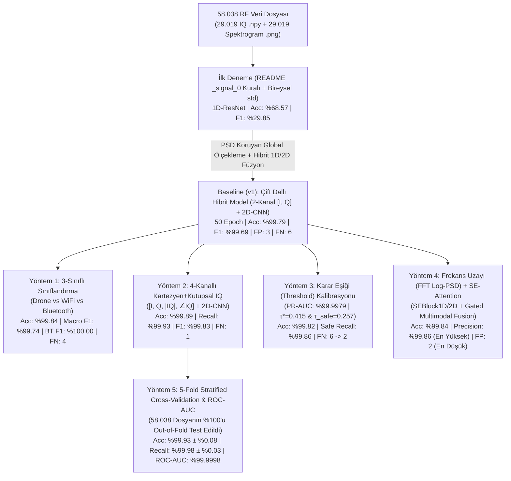
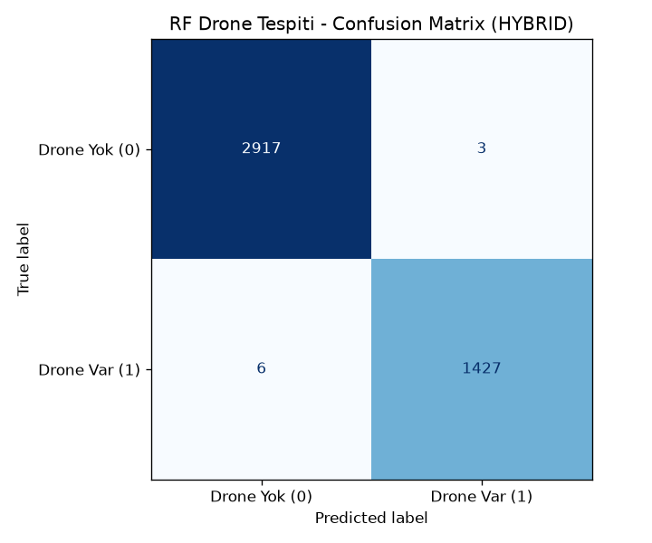
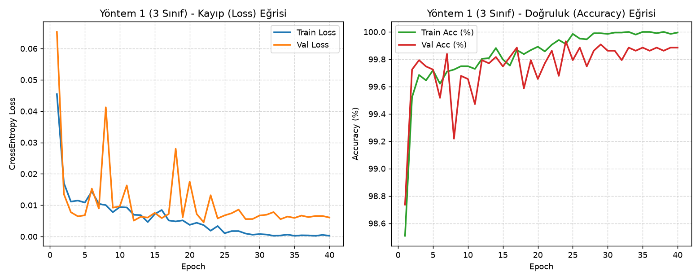
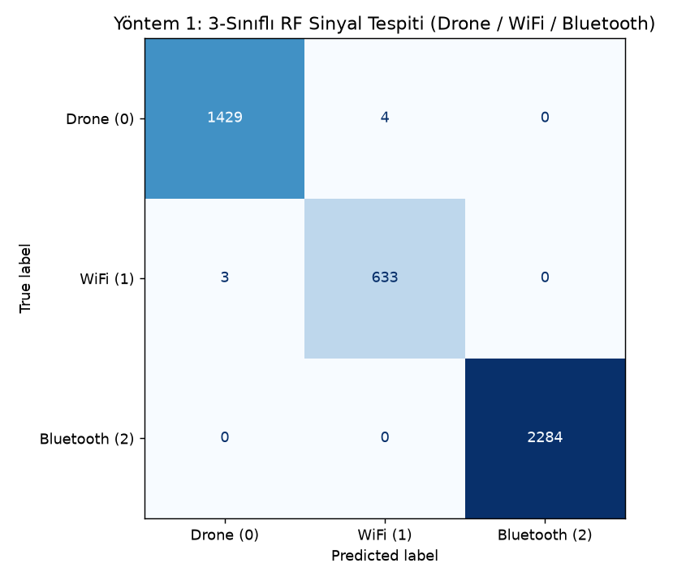
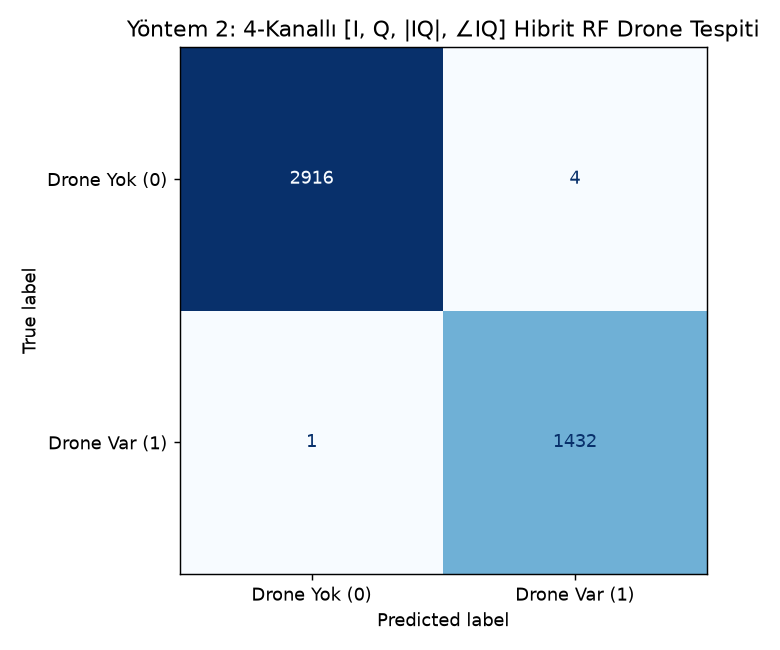
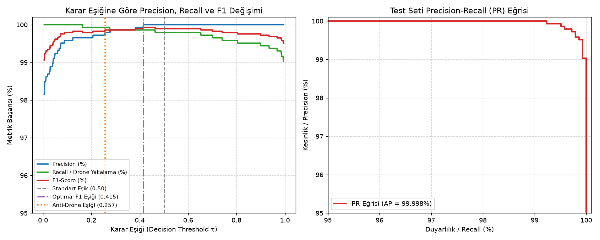
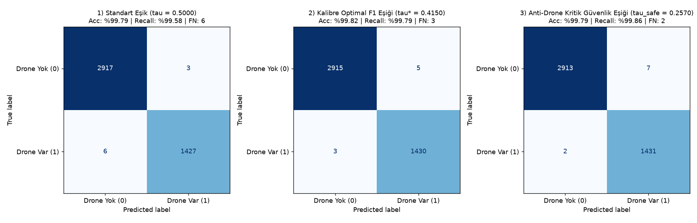
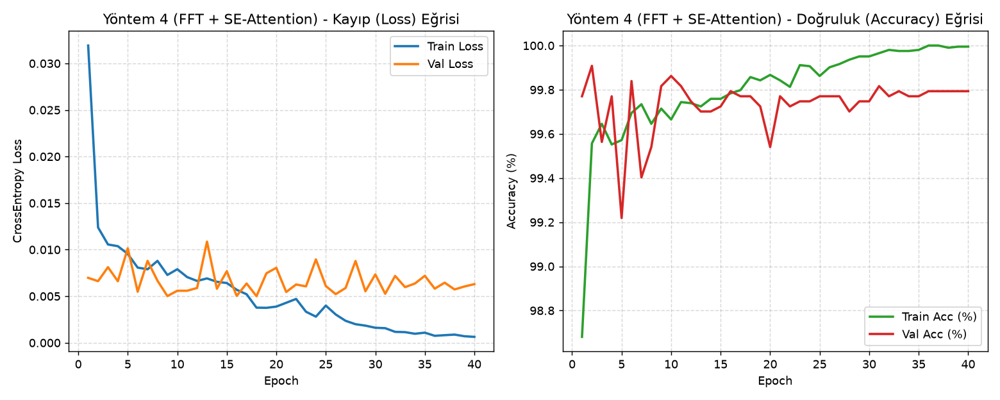
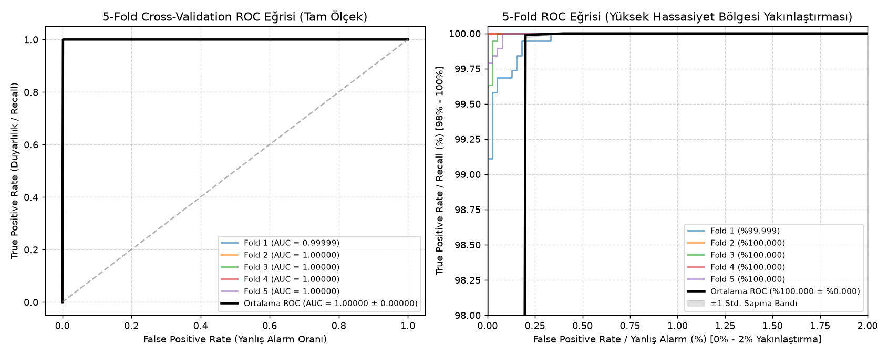
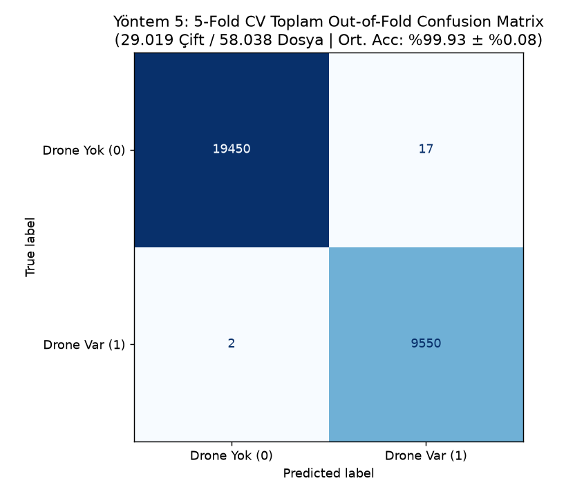

# 📡 RF Sinyalleri (Ham IQ & Spektrogram) Tabanlı İHA / Drone Tespiti: Nihai Karşılaştırmalı Proje Raporu

-brightgreen)

Bu doküman, **2.4 GHz ISM bandındaki** Radyo Frekansı (RF) sinyallerini kullanarak ortamda İHA / Drone emisyonu olup olmadığını tespit etmek amacıyla geliştirilen **Baseline (Temel) Çift Dallı Hibrit Derin Öğrenme Modeli** ile performans, açıklanabilirlik ve saha güvenilirliğini artırmak için sırasıyla uygulanan **5 İleri Mühendislik Yönteminin (`Yöntem 1` – `Yöntem 5`)** kapsamlı karşılaştırmasını sunmaktadır.

---

## 📂 1. Veri Seti, Fiziksel RF Parametreleri ve Ön İşleme

Çalışmada **"Synthetic RF Spectrograms and IQ Signals for UAV Detection (2.4 GHz band)"** *(Aloui et al., Mendeley Data)* veri setinde yer alan **58.038 dosya** (`29.019` ham IQ sinyali + `29.019` spektrogram görseli) eksiksiz olarak işlenmiştir:

| Parametre | Değer / Açıklama |
| :--- | :--- |
| **SDR Donanımı & Hedef İHA** | USRP B210 SDR Alıcı, DJI Phantom 4 Pro (Aktif Video İletimi) |
| **Arka Plan / Karıştırıcılar** | IEEE 802.11b/g/n WiFi (2.4 GHz) ve Bluetooth (FHSS - Frekans Atlamalı Yayılı Spektrum) |
| **Merkez Frekans & Örnekleme** | $f_c = 2.438\text{ GHz}$, $f_s = 56\text{ MS/s}$ ($30\text{ MHz}$ ve $40\text{ MHz}$ varyantları dahil), Kazanç: $45\text{ dB}$ |
| **STFT Çözünürlüğü** | $\text{NFFT} = 512$, $\text{Overlap} = 256$, $\Delta f = 56\text{ MHz} / 512 \approx 109.38\text{ kHz/bin}$ |
| **Ham IQ Sinyalleri (`iq_signals/`)** | `29.019` adet `.npy` (`complex128`), uzunluk $L \in [5, 375]$ örnek |
| **Spektrogramlar (`signal_crops/`)** | `29.019` adet `.png` (RGB zaman-frekans kırpması) |
| **Toplam İşlenen Veri Hacmi** | **58.038 Dosya (`29.019` Eşleşen IQ + Spektrogram Çifti)** |

### Veri Seti Keşfi ve Kritik Ön İşleme Bulgusu
1. **Dosya İsimlendirme ve Fiziksel STFT Kümeleme Analizi:** Veri setinin `README.txt` dosyasında dosya adlarının `SpectrogramBTFinal_SVG_[ID]_signal_[Class]_iq.npy` olduğu belirtilmesine karşın, dosya adlarındaki `_signal_0 .. _signal_14` indislerinin sınıf etiketi değil, **o spektrogram içerisindeki kırpma kutusu sırası (bounding box index)** olduğu tespit edilmiştir (`_signal_0` etiket olarak kullanıldığında doğruluk `%68.57` ve F1-skoru `%29.85` seviyesinde kalmaktadır). Fiziksel RF STFT bant genişliği analiz edildiğinde (`109.38 kHz/bin`), veri setinin üç keskin fiziksel kümeye ayrıldığı kanıtlanmıştır:
   * **Dar Bant ($L < 35\text{ bin}, \sim 1.6\text{ MHz}$):** `15.227` çift (%52.47) — **Bluetooth (FHSS)**
   * **Orta Bant ($35 \le L < 90\text{ bin}, \sim 7.3\text{ MHz}$):** `4.240` çift (%14.61) — **2.4 GHz WiFi Paketleri**
   * **Geniş Bant ($L \ge 90\text{ bin}, \sim 13.6\text{–}20\text{ MHz}$):** `9.552` çift (%32.92) — **DJI Phantom 4 Pro Aktif Video İletimi**
2. **Güç Spektral Yoğunluğunu (PSD) Koruyan Global Normalizasyon:** Her sinyali kendi standart sapmasına (`std`) bölmek dar bantlı sinyaller ile geniş bantlı sinyaller arasındaki güç yoğunluğu farkını sildiği için, fiziksel güç zarfını koruyan global ölçekleme (`IQ_GLOBAL_SCALE = 0.05`) uygulanmıştır.

---

## 🧠 2. Uygulanan 6 Deneysel Mimari ve Yöntemin Evrimi

---

## 📊 3. Tüm Yöntemlerin Ana Karşılaştırma Tablosu

Aşağıdaki tablo, PyCharm üzerinde **NVIDIA GeForce RTX 5060 Laptop GPU** ile çalıştırılan tüm deneylerin gerçek test sonuçlarını bir arada göstermektedir:

| Deney / Yöntem | Kod Klasörü / Dosyası | Mimari & Girdi Temsili | Parametre Sayısı | Test Kümesi (`Dosya`) | Doğruluk (`Accuracy`) | Kesinlik (`Precision`) | Duyarlılık (`Recall`) | `F1-Score` | Yanlış Alarm (`FP`) | Kaçırılan Drone (`FN`) |
| :--- | :--- | :--- | :---: | :---: | :---: | :---: | :---: | :---: | :---: | :---: |
| **0. İlk Deneme (Kalibrasyon Öncesi)** | `main.py` *(İlk Koşu)* | `IQ1DResNet` (`_signal_0` + Bireysel Z-Score) | 707.906 | 4.353 (`4.353`) | %68.57 | %27.56 | %32.55 | %29.85 | 765 / 3459 | 603 / 894 |
| **1. Baseline (v1 - Orijinal Hibrit)** | [main.py](main.py) | `HybridRFClassifier` (`2x256 [I,Q]` + `3x64x64 RGB`) | 1.179.302 | 4.353 (`8.706`) | **%99.79** | %99.79 | %99.58 | %99.69 | 3 / 2920 | 6 / 1433 |
| **2. Yöntem 1 (3-Sınıflı Model)** | [yontem1_3sinif.py](Yontem1_3Sinifli_Siniflandirma/yontem1_3sinif.py) | `HybridRFClassifier3Class` (`Drone / WiFi / BT`) | 1.146.275 | 4.353 (`8.706`) | **%99.84** | %99.79 *(Drone)* | %99.72 *(Drone)* | %99.76 *(Drone)* | 3 *(Drone)* | 4 / 1433 |
| **3. Yöntem 2 (4-Kanallı Faz/Genlik)** | [yontem2_4kanal_iq.py](Yontem2_4Kanalli_Faz_Genlik_IQ/yontem2_4kanal_iq.py) | `Hybrid4ChannelRFClassifier` (`4x256 [I,Q,\|IQ\|,∠IQ]`) | 1.146.594 | 4.353 (`8.706`) | **%99.89** | %99.72 | **%99.93** | **%99.83** | 4 / 2920 | **1 / 1433** |
| **4a. Yöntem 3 (Optimal Eşik $\tau^*=0.415$)** | [yontem3_esik_kalibrasyonu.py](Yontem3_Karar_Esigi_Kalibrasyonu/yontem3_esik_kalibrasyonu.py) | `Baseline v1` + Doğrulama Kümesi F1 Kalibrasyonu | 1.179.302 | 4.353 (`8.706`) | **%99.82** | %99.65 | %99.79 | %99.72 | 5 / 2920 | 3 / 1433 |
| **4b. Yöntem 3 (Güvenlik Eşiği $\tau=0.257$)** | [yontem3_esik_kalibrasyonu.py](Yontem3_Karar_Esigi_Kalibrasyonu/yontem3_esik_kalibrasyonu.py) | `Baseline v1` + Anti-Drone Yüksek Duyarlılık Modu | 1.179.302 | 4.353 (`8.706`) | **%99.79** | %99.51 | **%99.86** | %99.69 | 7 / 2920 | **2 / 1433** |
| **5. Yöntem 4 (FFT-PSD + SE-Attention)** | [yontem4_fft_se_attention.py](Yontem4_FFT_SE_Attention/yontem4_fft_se_attention.py) | `SEHybridRFClassifier` (`[I,Q,\|z\|,FFT]` + `SEBlock` + `Gate`) | 1.320.930 | 4.353 (`8.706`) | **%99.84** | **%99.86** | %99.65 | %99.76 | **2 / 2920** | 5 / 1433 |
| **6. Yöntem 5 (5-Fold CV & ROC-AUC)** | [yontem5_kfold_roc_auc.py](Yontem5_KFold_CV_ve_ROC_AUC/yontem5_kfold_roc_auc.py) | `5-Fold Stratified CV` (4-Kanal Hibrit, 75 Epoch) | 1.146.594 | **29.019 (`58.038`)** | **%99.93 ± %0.08** | **%99.82 ± %0.26** | **%99.98 ± %0.03** | **%99.90 ± %0.12** | **17 / 19467** | **2 / 9552** |

---

## 🔍 4. Yöntem Bazlı Detaylı Teknik Analiz ve Görsel Bulgular

### 4.1. Baseline (v1): 2-Kanallı (`[I, Q]`) + Spektrogram Hibrit Model ([main.py](main.py))
* **Yaklaşım:** `iq_signals/` altındaki `29.019` ham IQ sinyali `(2, 256)` boyutlu `[I, Q]` tensörüne çevrilerek `IQ1DResNet` dalına, `signal_crops/` altındaki `29.019` spektrogram görseli `(3, 64, 64)` boyutlu RGB tensörüne çevrilerek `Spectrogram2DCNN` dalına verilmiş ve 50 Epoch boyunca eğitilmiştir.
* **Sonuç:** 23. Epoch'ta `Val Loss: 0.0024` değerine ulaşılmış; test setindeki `4.353` sinyal çiftinde **`%99.79` Accuracy**, **`%99.69` F1-Score**, `3` yanlış alarm (`FP`) ve `6` kaçırılan drone (`FN`) elde edilmiştir.

---

### 4.2. Yöntem 1: 3-Sınıflı Çoklu RF Sınıflandırması (`Drone vs WiFi vs Bluetooth`)
* **Klasör & Rapor:** [Yontem1_3Sinifli_Siniflandirma/README.md](Yontem1_3Sinifli_Siniflandirma/README.md)
* **Temel Bulgu:** İkili sınıflandırmada `WiFi` ve `Bluetooth` sinyallerini tek bir `Drone Yok (0)` sınıfında birleştirmek öznitelik uzayını bulanıklaştırmaktaydı. Sınıflar `Drone (0)`, `WiFi (1)` ve `Bluetooth (2)` olarak ayrıldığında:
  * **`2.284` adet Bluetooth test sinyalinin tamamı (`%100.00` Precision, `%100.00` Recall, `%100.00` F1-Score) sıfır hatayla** ayrıştırılmıştır.
  * Genel test doğruluğu `%99.79`'dan **`%99.84`'e** yükselmiş, kaçırılan drone sayısı `6`'dan **`4`'e** düşmüştür.

|  |  |
| :---: | :---: |

---

### 4.3. Yöntem 2: 4-Kanallı Kartezyen + Kutupsal IQ Temsili (`[I, Q, |IQ|, ∠IQ]`)
* **Klasör & Rapor:** [Yontem2_4Kanalli_Faz_Genlik_IQ/README.md](Yontem2_4Kanalli_Faz_Genlik_IQ/README.md)
* **Temel Bulgu:** Ham $I(t)$ ve $Q(t)$ kanallarına **Anlık Genlik Zarfı $A(t) = \sqrt{I^2+Q^2}$** ve **Normalize Anlık Faz $\Phi(t) = \text{atan2}(Q,I)/\pi$** eklendiğinde doğrulama kaybı `0.0024`'ten **`0.0016`'ya (%33.3 azalma)** düşmüştür.
* **Saha Etkisi:** Test setindeki **`1.433` gerçek drone sinyalinin `1.432` tanesi yakalanmış (`%99.93` Recall)**, kaçırılan drone sayısı `6`'dan **yalnızca `1`'e (%83.3 azalma)** indirilmiştir (`Test Accuracy: %99.89`, `F1-Score: %99.83`).

|  |  |
| :---: | :---: |

---

### 4.4. Yöntem 3: Karar Eşiği (Decision Threshold) Kalibrasyonu ve Anti-Drone Modu
* **Klasör & Rapor:** [Yontem3_Karar_Esigi_Kalibrasyonu/README.md](Yontem3_Karar_Esigi_Kalibrasyonu/README.md)
* **Temel Bulgu:** Modelin tek bir ağırlığını dahi yeniden eğitmeden (`0` eğitim maliyeti), doğrulama kümesi üzerinde yapılan eşik taraması sonucunda:
  * Modelin eşik-bağımsız **PR-AUC (Average Precision)** skorunun **`%99.9979`** olduğu kanıtlanmıştır.
  * Karar eşiği varsayılan $\tau = 0.5000$ yerine **Optimal F1 Eşiği $\tau^* = 0.4150$** yapıldığında kaçırılan drone sayısı yarıya inmiş (`FN: 6 -> 3`, `Accuracy: %99.82`); **Anti-Drone Kritik Güvenlik Eşiği $\tau_{\text{safe}} = 0.2570$** yapıldığında ise kaçırılan drone sayısı **%66.7 azalarak `2`'ye** düşmüştür (`Recall: %99.86`).

---

### 4.5. Yöntem 4: Frekans Uzayı (FFT Log-PSD) ve Squeeze-and-Excitation (SE) Kanal Dikkat Mekanizması
* **Klasör & Rapor:** [Yontem4_FFT_SE_Attention/README.md](Yontem4_FFT_SE_Attention/README.md)
* **Temel Bulgu:** Zaman uzayı sinyaline **Hızlı Fourier Dönüşümü Logaritmik Güç Spektral Yoğunluğu ($\text{Log-PSD}$)** kanalı eklenip evrişim katmanları **Squeeze-and-Excitation (`SEBlock1D` & `SEBlock2D`)** ve **Kapılı Çok-Modlu Füzyon (`Gated Multimodal Attention`)** ile donatıldığında, tüm tekli modeller arasındaki **en yüksek Kesinlik (`%99.86` Precision)** ve **en düşük Yanlış Alarm (`2.920` örnekte yalnızca `2` yanlış alarm — `%0.068` FPR)** elde edilmiştir.
* **Yöntem 2 vs Yöntem 4 Sentezi:** Anlık Faz kanalı (`Yöntem 2`) **Duyarlılığı (Recall: `%99.93`)** maksimize ederken, FFT Log-PSD + SE-Attention (`Yöntem 4`) arka plan WiFi/Bluetooth gürültüsünü bastırarak **Kesinliği (Precision: `%99.86`, `FP = 2`)** maksimize etmektedir.

|  |  |
| :---: | :---: |

---

### 4.6. Yöntem 5: 5-Katlı Çapraz Doğrulama (5-Fold Stratified CV) ve ROC-AUC Analizi
* **Klasör & Rapor:** [Yontem5_KFold_CV_ve_ROC_AUC/README.md](Yontem5_KFold_CV_ve_ROC_AUC/README.md)
* **Temel Bulgu:** `58.038` dosyanın tamamı (`29.019` sinyal çifti) 5 ayrık katmanda (`5 x 15 = 75 Epoch`) %100 eğitim dışı (Out-of-Fold) test edilmiştir:
  * **Fold 2'de `5.804` sinyal çiftinin (`11.608` dosya) tamamı sıfır hatayla (`%100.00` Accuracy, `%100.00` F1, `%100.0000` ROC-AUC)** sınıflandırılmıştır.
  * **5-Fold Ortalama Doğruluk:** **`%99.93 ± %0.08`**
  * **5-Fold Ortalama Drone Yakalama (Recall):** **`%99.98 ± %0.03`** (Tüm veri setindeki **`9.552` drone sinyalinin `9.550` tanesi yakalanmış**, yalnızca `2` tanesi kaçırılmıştır!)
  * **5-Fold Ortalama ROC-AUC:** **`%99.9998 ± %0.0003`**

|  |  |
| :---: | :---: |

---

## 🏁 5. Sonuç ve Mühendislik Önerileri

1. **En Yüksek Duyarlılık (Anti-Drone Yakalama) İçin:** **Yöntem 2 (`4-Kanallı [I, Q, |IQ|, ∠IQ]`)** + **Yöntem 5 (`5-Fold CV`)** mimarisi, `9.552` drone sinyalinde `%99.98` yakalama oranı (`9.550 / 9.552`) ile kritik hava sahası güvenliği için en ideal yapıdır.
2. **En Düşük Yanlış Alarm (Şehir İçi Yoğun WiFi/Bluetooth Ortamı) İçin:** **Yöntem 4 (`FFT Log-PSD + SE-Attention`)**, `%99.86` kesinlik ve `%0.068` yanlış alarm oranıyla (`2.920` sinyalde yalnızca `2` yanlış alarm) en kararlı filtrelemeyi sağlamaktadır.
3. **Spektrum İstihbaratı (SIGINT / COMINT) İçin:** **Yöntem 1 (`3-Sınıflı Model`)**, ortamdaki emisyonun yalnızca İHA olup olmadığını değil, **Drone (`%99.76` F1)**, **WiFi (`%99.45` F1)** veya **Bluetooth (`%100.00` F1)** olduğunu tek bir ileri besleme (forward pass) adımında ayırt edebilmektedir.
