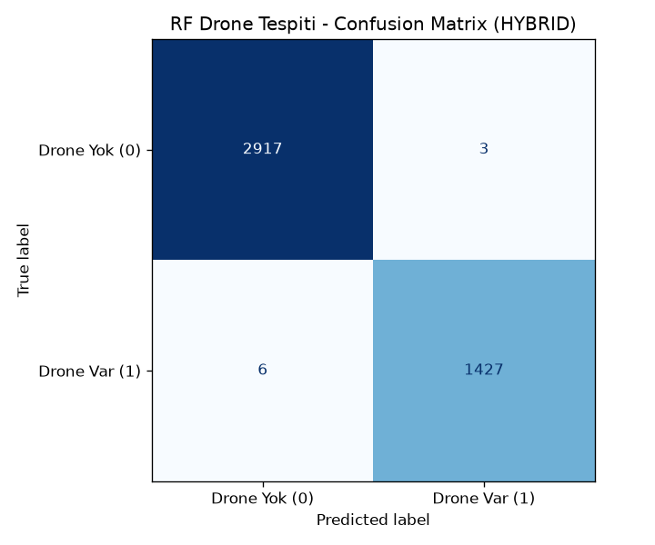

# 📡 RF Tabanlı İHA / Drone Tespiti: Hibrit Derin Öğrenme (1D-ResNet + 2D-CNN) Çalışması


Bu çalışma, **2.4 GHz ISM bandındaki** Radyo Frekansı (RF) emisyonlarını kullanarak ortamda **İHA / Drone sinyali olup olmadığını (Binary Classification: Drone Var / Drone Yok)** yüksek doğrulukla tespit eden **Çift Dallı Hibrit Derin Öğrenme (`HybridRFClassifier`: 1D-ResNet + 2D-CNN)** mimarisini, eğitim bulgularını ve deneysel sonuçlarını içermektedir.

---

## 📂 1. Veri Seti ve Fiziksel RF Parametreleri

Çalışmada Mendeley Data üzerinde yayımlanan **"Synthetic RF Spectrograms and IQ Signals for UAV Detection (2.4 GHz band)"** *(Aloui et al.)* veri seti kullanılmıştır.

* **Donanım ve Kayıt Parametreleri:**
  * **SDR Alıcı:** USRP B210 Software-Defined Radio
  * **Hedef İHA:** DJI Phantom 4 Pro (Aktif video/telemetri iletimi)
  * **Arka Plan / Karıştırıcı Sinyaller:** 2.4 GHz WiFi (aktif/boşta) ve Bluetooth (FHSS - Frekans Atlamalı Yayılı Spektrum)
  * **Merkez Frekans:** $f_c = 2.438\text{ GHz}$
  * **Örnekleme Hızı:** $f_s = 56\text{ MS/s}$ (30 ve 40 MHz varyantları dahil)
  * **Alıcı Kazancı:** $45\text{ dB}$
  * **Zaman-Frekans Dönüşümü (STFT):** $\text{NFFT} = 512$, $\text{Overlap} = 256$, Viridis renk haritası ($\Delta f = 56\text{ MHz} / 512 \approx 109.38\text{ kHz/bin}$)

* **Veri Seti Hacmi ve Eşleşen Çift Yapısı (`58.038` Dosya):**
  * `iq_signals/` : **29.019 adet** `.npy` formatında (`complex128`), uzunluğu $L \in [5, 375]$ arasında değişen ham karmaşık (In-phase / Quadrature) taban bant sinyali.
  * `signal_crops/`: **29.019 adet** `.png` formatında RGB spektrogram kırpması.
  * **Toplam:** **58.038 adet** RF veri dosyası (%100'ü hibrit eğitim hattında birlikte işlenmiştir).

### Veri Bölünmesi (Stratified Train / Validation / Test Split)

Sınıf dağılım oranları korunarak (`stratify`) veri seti **%70 Eğitim**, **%15 Doğrulama**, **%15 Test** olarak ayrılmıştır:

| Veri Kümesi | Sinyal Çifti Sayısı | İşlenen Toplam Dosya (`.npy` + `.png`) | Oran |
| :--- | :---: | :---: | :---: |
| **Train (Eğitim)** | 20.313 | 40.626 | %70.0 |
| **Validation (Doğrulama)** | 4.353 | 8.706 | %15.0 |
| **Test (Hiç Görülmemiş)** | 4.353 | 8.706 | %15.0 |
| **TOPLAM** | **29.019** | **58.038** | **%100.0** |

* **Sınıf Dağılımı:**
  * `Sınıf 0 (Drone Yok - WiFi / Bluetooth)`: **19.467 çift** (%67.08)
  * `Sınıf 1 (Drone Var - Geniş Bant İHA Video İletimi)`: **9.552 çift** (%32.92)

---

## 🧠 2. Önerilen Model Mimarisi (`HybridRFClassifier`)

Hem zaman/frekans zarfındaki karmaşık $I/Q$ genlik değişimlerini hem de spektrogram üzerindeki 2-boyutlu görsel enerji dağılımını aynı anda öğrenmek için **1.179.302 eğitilebilir parametreye** sahip çift dallı (multimodal) bir mimari tasarlanmıştır:

```mermaid
flowchart LR
    subgraph Input["Girdi Katmanı (58.038 Dosya)"]
        IQ["Ham IQ Sinyali (.npy)\ncomplex128 -> (2, 256)"]
        SPEC["Spektrogram Kırpması (.png)\nRGB -> (3, 64, 64)"]
    end

    subgraph Branch1D["1D-ResNet Dalı (IQ1DResNet)"]
        S1["Conv1D(2->32, k=7) + BN + GELU"]
        R1["ResidualBlock1D(32->64, s=2)"]
        R2["ResidualBlock1D(64->128, s=2)"]
        R3["ResidualBlock1D(128->256, s=2)"]
        P1["AdaptiveAvgPool1d(1) -> 256-d"]
        S1 --> R1 --> R2 --> R3 --> P1
    end

    subgraph Branch2D["2D-CNN Dalı (Spectrogram2DCNN)"]
        C1["Conv2D(3->32) + BN + GELU + MaxPool"]
        C2["Conv2D(32->64) + BN + GELU + MaxPool"]
        C3["Conv2D(64->128) + BN + GELU + MaxPool"]
        C4["Conv2D(128->256) + BN + GELU"]
        P2["AdaptiveAvgPool2d(1,1) -> 256-d"]
        C1 --> C2 --> C3 --> C4 --> P2
    end

    subgraph Fusion["Füzyon ve Sınıflandırıcı"]
        CAT["Concatenate (256 + 256 = 512-d)"]
        FC["Dropout(0.3) -> Linear(512->128) + GELU\n-> Dropout(0.2) -> Linear(128->2)"]
        OUT["Çıktı: Drone Yok (0) / Drone Var (1)"]
        CAT --> FC --> OUT
    end

    IQ --> S1
    SPEC --> C1
    P1 --> CAT
    P2 --> CAT
```



### Ön İşleme ve Optimizasyon Teknikleri
1. **Güç Spektral Yoğunluğu (PSD) Koruyan Global Ölçekleme:** Her sinyali kendi standart sapmasına (`std`) bölmek dar bantlı sinyaller ile geniş bantlı İHA sinyalleri arasındaki güç yoğunluğu farkını sildiği için, fiziksel güç zarfını koruyan global ölçekleme (`IQ_GLOBAL_SCALE = 0.05`) uygulanmıştır.
2. **16-Thread Paralel Ön-Yükleme ve Sıkıştırılmış Tensör Önbelleği:** 58.038 küçük dosyanın Windows NTFS üzerinde her epoch'ta tekrar açılmasından kaynaklanan I/O darboğazını önlemek için 16 iş parçacıklı `ThreadPoolExecutor` kullanılmış; tüm veri seti **17.2 saniyede** sıkıştırılmış `uint8` (spektrogram) ve `float32` (IQ) tensörleri olarak (~415 MB RAM) belleğe alınmıştır.
3. **Sınıf Ağırlıklı Kayıp Fonksiyonu (`Weighted CrossEntropyLoss`):** `19.467` (`Drone Yok`) ve `9.552` (`Drone Var`) arasındaki sınıf dengesizliğini gidermek için ters frekans ağırlıklandırması uygulanmıştır.

---

## 📈 3. Deneysel Sonuçlar (v1 - Baseline Hibrit Model)

Eğitim **NVIDIA GeForce RTX 5060 Laptop GPU** üzerinde **50 Epoch** boyunca kesintisiz çalıştırılmış, `CosineAnnealingLR` öğrenme oranı zamanlayıcısı kullanılmış ve en düşük doğrulama kaybı **23. Epoch'ta (`Val Loss: 0.0024`, `Val Acc: %99.93`)** elde edilmiştir.

### Seçilmiş Epoch Özeti (50 Epoch Tam Eğitim)

| Epoch | Süre (sn) | Train Loss | Train Acc (%) | Val Loss | Val Acc (%) | Learning Rate | Durum |
| :---: | :---: | :---: | :---: | :---: | :---: | :---: | :---: |
| **01 / 50** | 9.2s | 0.0348 | %98.29 | 0.0069 | %99.59 | `1.00e-03` | ★ En İyi |
| **02 / 50** | 5.9s | 0.0099 | %99.55 | 0.0067 | %99.77 | `9.99e-04` | ★ En İyi |
| **05 / 50** | 6.0s | 0.0077 | %99.71 | 0.0045 | %99.84 | `9.84e-04` | ★ En İyi |
| **09 / 50** | 6.0s | 0.0084 | %99.67 | 0.0045 | %99.86 | `9.38e-04` | ★ En İyi |
| **16 / 50** | 5.7s | 0.0037 | %99.87 | 0.0038 | %99.89 | `7.94e-04` | ★ En İyi |
| **23 / 50** | **5.8s** | **0.0020** | **%99.93** | **0.0024** | **%99.93** | **`5.94e-04`** | **★ ZİRVE (Kaydedilen Model)** |
| **30 / 50** | 5.8s | 0.0004 | %100.00 | 0.0045 | %99.79 | `3.76e-04` | Tamamlandı |
| **50 / 50** | 5.9s | 0.0001 | %100.00 | 0.0037 | %99.89 | `1.99e-06` | Eğitim Sonu |

---

### Test Seti Performans Metrikleri (4.353 Çift / 8.706 Dosya)

| Sınıf | Kesinlik (Precision) | Duyarlılık (Recall) | F1-Skoru (F1-Score) | Örnek Sayısı (Support) |
| :--- | :---: | :---: | :---: | :---: |
| **Drone Yok (0)** | %99.79 (`0.9979`) | %99.90 (`0.9990`) | %99.85 (`0.9985`) | 2.920 |
| **Drone Var (1)** | %99.79 (`0.9979`) | %99.58 (`0.9958`) | %99.69 (`0.9969`) | 1.433 |
| **Macro Avg** | **%99.79 (`0.9979`)** | **%99.74 (`0.9974`)** | **%99.77 (`0.9977`)** | **4.353** |
| **Weighted Avg / Accuracy** | **%99.79 (`0.9979`)** | **%99.79 (`0.9979`)** | **%99.79 (`0.9979`)** | **4.353** |

### Karmaşıklık Matrisi (Confusion Matrix)



| Gerçek \ Tahmin | Tahmin: Drone Yok (0) | Tahmin: Drone Var (1) |
| :--- | :---: | :---: |
| **Gerçek: Drone Yok (0)** | **2.917** *(True Negative - TN)* | **3** *(False Positive - Yanlış Alarm: %0.10)* |
| **Gerçek: Drone Var (1)** | **6** *(False Negative - Kaçırılan: %0.42)* | **1.427** *(True Positive - Doğru Tespit: %99.58)* |

---

## 🚀 4. Kurulum ve Çalıştırma

```bash
# 1. Gerekli kütüphanelerin kurulması (CUDA 12.8 destekli PyTorch)
pip install torch torchvision torchaudio --index-url https://download.pytorch.org/whl/cu128
pip install -r requirements.txt

# 2. Baseline Hibrit Modelin (v1) çalıştırılması
python train_v1_baseline_hybrid.py
```

---

## 🛠️ 5. Adım Adım Geliştirme Yol Haritası (Deneysel İyileştirme Serisi)

Modelin performansını, açıklanabilirliğini ve zorlu saha koşullarına dayanıklılığını daha da ileri taşımak için aşağıdaki iyileştirmeler sırasıyla uygulanmakta ve karşılaştırılmaktadır:

- [x] **v1 (`train_v1_baseline_hybrid.py`):** 2-Kanallı (`I, Q`) 1D-ResNet + 2D-CNN Hibrit Model (`Test Acc: %99.79`, `F1: %99.69`, `FN: 6`, `FP: 3`)
- [ ] **v2 (Adım 1 - 4 Kanallı Faz/Genlik Zarfı & FFT Spektral Öznitelikleri):** Ham `[I, Q]` kanallarına ek olarak Anlık Genlik Zarfı $|z(t)| = \sqrt{I^2+Q^2}$ ve Anlık Faz/Frekans $\phi(t) = \text{atan2}(Q,I)/\pi$ kanallarının (`4x256`) eklenmesi.
- [ ] **v3 (Adım 2 - Kanal Dikkat Mekanizması [Squeeze-and-Excitation / SE-ResNet] & Karar Eşiği Optimizasyonu):** Kaçırılan drone sayısını (`FN = 6`) sıfıra indirmek için SE-Attention blokları ve ROC tabanlı karar eşiği (threshold) kalibrasyonu.
- [ ] **v4 (Adım 3 - 3 Sınıflı Çoklu Sınıflandırma [Drone vs WiFi vs Bluetooth] & Eğitim/ROC-AUC Eğrileri):** Ortamdaki sinyalin yalnızca drone olup olmadığını değil, türünü de (`Class 0: Drone`, `Class 1: WiFi`, `Class 2: Bluetooth`) ayırt eden model ve kapsamlı görsel analiz grafikleri (Loss/Accuracy Curves + ROC-AUC).
