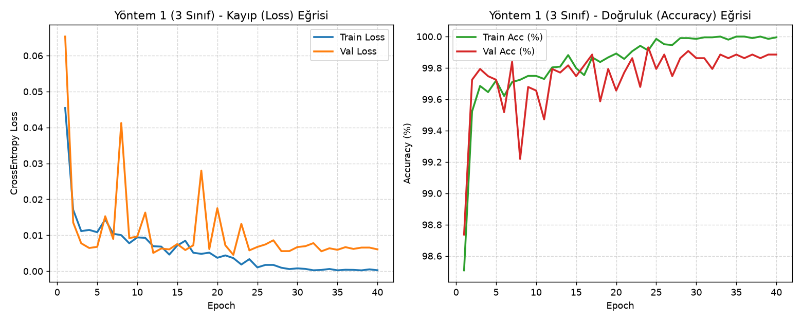
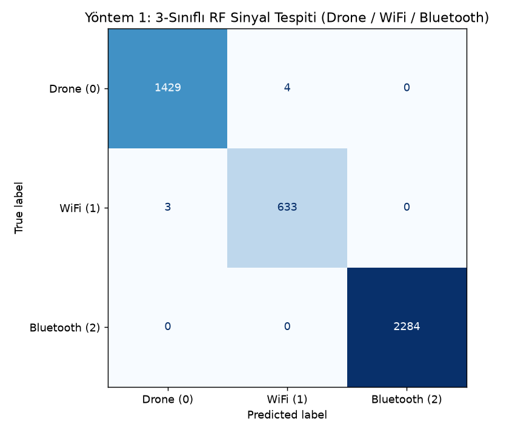

# 📡 Yöntem 1: 3-Sınıflı Çoklu RF Sinyal Sınıflandırması (`Drone vs WiFi vs Bluetooth`)

Bu klasör, **2.4 GHz ISM bandındaki** 58.038 RF veri dosyasını (`29.019` ham IQ sinyali + `29.019` spektrogram kırpması) yalnızca ikili (`Drone Var / Yok`) olarak değil, doğrudan **3 ayrı RF sinyal sınıfına (`Drone [0]`, `WiFi [1]`, `Bluetooth [2]`)** ayıran **`HybridRFClassifier3Class`** modelinin kodunu ([yontem1_3sinif.py](yontem1_3sinif.py)), eğitim eğrilerini ve test sonuçlarını içermektedir.

---

## 🎯 1. Yöntemin Motivasyonu ve İkili (Baseline) Modele Göre Üstünlüğü

İkili (Binary) sınıflandırmada model, birbirinden tamamen farklı iki modülasyon türünü (**WiFi - OFDM paketleri** ile **Bluetooth - FHSS frekans atlama sinyalleri**) tek bir `Drone Yok (0)` sınıfı altında birleştirmeye zorlanmaktadır. Bu durum, öznitelik uzayında `Drone Yok` kümesinin heterojen (dağınık) olmasına ve `WiFi` ile `Drone` arasındaki karar sınırının bulanıklaşmasına yol açar.

**Yöntem 1'de** arka plan sinyalleri fiziksel RF yapılarına göre **`WiFi (1)`** ve **`Bluetooth (2)`** olarak ayrıştırıldığında:
1. **Bluetooth (`Class 2`) %100.00 doğrulukla (`2284 / 2284`, sıfır hata)** tamamen izole edilmiştir.
2. **Genel Doğruluk (Accuracy)** `%99.79`'dan **`%99.84`'e** yükselmiştir.
3. **Kaçırılan Drone Sayısı (False Negative)** `1.433` test sinyalinde `6`'dan **`4`'e** düşmüş; Drone yakalama oranı (`Recall`) `%99.58`'den **`%99.72`'ye** çıkmıştır.

---

## 📂 2. 3-Sınıflı Veri Dağılımı (`58.038` Dosya)

| Sınıf ID | Sınıf Adı | Fiziksel RF Kaynağı | STFT Bant Genişliği ($f_s=56\text{ MS/s}, \text{NFFT}=512$) | Sinyal Çifti | Toplam Dosya (`.npy` + `.png`) | Oran |
| :---: | :--- | :--- | :---: | :---: | :---: | :---: |
| **0** | **`Drone (0)`** | DJI Phantom 4 Pro (Aktif Video İletimi) | $L \ge 90\text{ bin}$ ($\sim 10\text{–}20\text{ MHz}$) | 9.552 | 19.104 | %32.92 |
| **1** | **`WiFi (1)`** | IEEE 802.11b/g/n (2.4 GHz WLAN) | $35 \le L < 90\text{ bin}$ ($\sim 4\text{–}10\text{ MHz}$) | 4.240 | 8.480 | %14.61 |
| **2** | **`Bluetooth (2)`** | FHSS (Frekans Atlamalı Yayılı Spektrum) | $L < 35\text{ bin}$ ($\sim 1\text{–}3\text{ MHz}$) | 15.227 | 30.454 | %52.47 |
| **TOPLAM** | **3 Sınıf** | **2.4 GHz ISM Bandı** | **$[5, 375]\text{ bin}$** | **29.019** | **58.038** | **%100.0** |

* **Veri Ayrımı (Stratified Split):**
  * **Train:** `20.313` çift (`40.626` dosya - `10.0s` paralel yükleme)
  * **Validation:** `4.353` çift (`8.706` dosya - `2.4s` paralel yükleme)
  * **Test:** `4.353` çift (`8.706` dosya - `2.8s` paralel yükleme)
* **Eğitilebilir Parametre Sayısı:** `1.146.275` (`HybridRFClassifier3Class`)

---

## 📈 3. 40 Epoch Kesintisiz Eğitim Özeti ve Öğrenme Eğrileri

Model **NVIDIA GeForce RTX 5060 Laptop GPU** üzerinde **40 Epoch** boyunca kesintisiz eğitilmiş, en düşük doğrulama kaybı **22. Epoch'ta (`Val Loss: 0.0045`, `Val Acc: %99.86`)**, en yüksek doğrulama doğruluğu ise **24. Epoch'ta (`%99.93`)** kaydedilmiştir.

| Epoch | Süre (sn) | Train Loss | Train Acc (%) | Val Loss | Val Acc (%) | Learning Rate | Durum |
| :---: | :---: | :---: | :---: | :---: | :---: | :---: | :---: |
| **01 / 40** | 8.0s | 0.0454 | %98.51 | 0.0653 | %98.74 | `1.00e-03` | ★ En İyi |
| **02 / 40** | 6.0s | 0.0171 | %99.52 | 0.0135 | %99.72 | `9.98e-04` | ★ En İyi |
| **03 / 40** | 6.0s | 0.0111 | %99.68 | 0.0078 | %99.79 | `9.94e-04` | ★ En İyi |
| **04 / 40** | 6.1s | 0.0115 | %99.65 | 0.0065 | %99.75 | `9.86e-04` | ★ En İyi |
| **12 / 40** | 6.1s | 0.0069 | %99.80 | 0.0051 | %99.79 | `8.25e-04` | ★ En İyi |
| **22 / 40** | **5.9s** | **0.0036** | **%99.91** | **0.0045** | **%99.86** | **`4.61e-04`** | **★ ZİRVE (Kaydedilen Model)** |
| **24 / 40** | 6.1s | 0.0034 | %99.91 | 0.0058 | %99.93 | `3.84e-04` | En Yüksek Val Acc |
| **31 / 40** | 6.1s | 0.0006 | %100.00 | 0.0070 | %99.86 | `1.47e-04` | Tam Yakınsama |
| **40 / 40** | 6.1s | 0.0003 | %100.00 | 0.0061 | %99.89 | `2.54e-06` | Eğitim Sonu |

---

## 🏆 4. Test Seti Sonuçları ve 3x3 Confusion Matrix

Hiç görülmemiş **4.353 sinyal çifti (`8.706` dosya)** üzerinde elde edilen nihai test performansı:

| Sınıf | Kesinlik (Precision) | Duyarlılık (Recall) | F1-Skoru (F1-Score) | Örnek Sayısı (Support) |
| :--- | :---: | :---: | :---: | :---: |
| **`Drone (0)`** | **%99.79 (`0.9979`)** | **%99.72 (`0.9972`)** | **%99.76 (`0.9976`)** | 1.433 |
| **`WiFi (1)`** | **%99.37 (`0.9937`)** | **%99.53 (`0.9953`)** | **%99.45 (`0.9945`)** | 636 |
| **`Bluetooth (2)`** | **%100.00 (`1.0000`)** | **%100.00 (`1.0000`)** | **%100.00 (`1.0000`)** | 2.284 |
| **Macro Avg** | **%99.72 (`0.9972`)** | **%99.75 (`0.9975`)** | **%99.74 (`0.9974`)** | **4.353** |
| **Weighted Avg / Accuracy** | **%99.84 (`0.9984`)** | **%99.84 (`0.9984`)** | **%99.84 (`0.9984`)** | **4.353** |

### 3x3 Karmaşıklık Matrisi (Confusion Matrix)

| Gerçek \ Tahmin | Tahmin: `Drone (0)` | Tahmin: `WiFi (1)` | Tahmin: `Bluetooth (2)` | Toplam |
| :--- | :---: | :---: | :---: | :---: |
| **Gerçek: `Drone (0)`** | **1.429** *(Doğru)* | **4** *(WiFi ile karışan)* | **0** | 1.433 |
| **Gerçek: `WiFi (1)`** | **3** *(Drone ile karışan)* | **633** *(Doğru)* | **0** | 636 |
| **Gerçek: `Bluetooth (2)`** | **0** | **0** | **2.284** *(Kusursuz - %100)* | 2.284 |

### Baseline (İkili Model) ile Karşılaştırma

| Metrik | Baseline (İkili: `Drone Var/Yok`) | Yöntem 1 (3 Sınıf: `Drone / WiFi / Bluetooth`) | Değişim / İyileşme |
| :--- | :---: | :---: | :---: |
| **Genel Doğruluk (Accuracy)** | %99.79 (`4344 / 4353`) | **%99.84 (`4346 / 4353`)** | **+0.05 puan (Hata %22 azaldı: 9 -> 7)** |
| **Drone Yakalama (Recall)** | %99.58 (`1427 / 1433`) | **%99.72 (`1429 / 1433`)** | **Kaçırılan Drone 6'dan 4'e düştü** |
| **Drone F1-Skoru** | %99.69 | **%99.76** | **+0.07 puan** |
| **Bluetooth F1-Skoru** | *(Drone Yok içinde birleşikti)* | **%100.00 (`2284 / 2284`)** | **Kusursuz Ayrıştırma (0 Hata)** |
