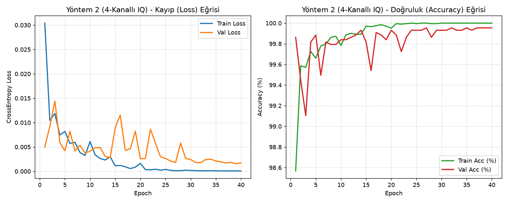
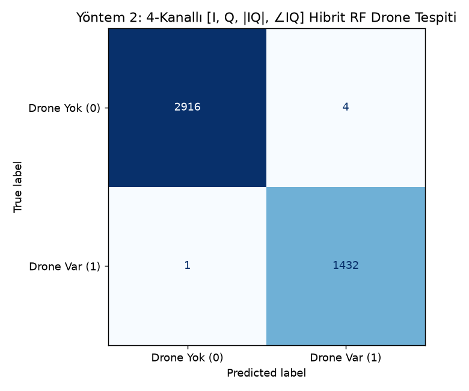

# 📡 Yöntem 2: 4-Kanallı Kartezyen + Kutupsal IQ Temsili (`[I, Q, |IQ|, ∠IQ]`) ile Hibrit RF Drone Tespiti

-brightgreen)

Bu klasör, 1D-ResNet dalına yalnızca 2 kanallı Kartezyen `[I(t), Q(t)]` vermek yerine, **Anlık Genlik Zarfı $|z(t)|$** ve **Normalize Anlık Faz $\angle z(t)$** kanallarını da ekleyerek **(4, 256) boyutlu Kartezyen + Kutupsal (Cartesian + Polar) RF sinyal temsili** kullanan `Hybrid4ChannelRFClassifier` modelinin kodunu ([yontem2_4kanal_iq.py](yontem2_4kanal_iq.py)), öğrenme eğrilerini ve test sonuçlarını içermektedir.

---

## 🎯 1. Yöntemin Matematiksel Temeli ve Motivasyonu

Karmaşık taban-bant (complex baseband) RF sinyali $z(t) = I(t) + jQ(t)$ yalnızca Kartezyen bileşenleriyle verildiğinde, 1D evrişim katmanlarının karekök ve arktanjant gibi doğrusal olmayan (non-linear) modülasyon zarflarını ilk katmanlarda yakalaması güçleşir. Bu nedenle her sinyal 4 fiziksel kanallı bir tensöre dönüştürülmüştür:

$$
\mathbf{X}_{\text{IQ}}(t) = \begin{bmatrix} I(t) / s \\ Q(t) / s \\ A(t) / s = \frac{1}{s}\sqrt{I(t)^2 + Q(t)^2} \\ \Phi(t) = \frac{1}{\pi}\text{atan2}\big(Q(t), I(t)\big) \end{bmatrix} \in \mathbb{R}^{4 \times 256}
$$

1. **$A(t)$ (Anlık Genlik Zarfı):** DJI Phantom 4 Pro video iletiminin kullandığı çok taşıyıcılı **OFDM** sinyalleri yüksek Tepe-Ortalama Güç Oranına (PAPR) sahipken, Bluetooth **GFSK/FHSS** sinyalleri sabit zarflı (constant-envelope) yapıdadır.
2. **$\Phi(t)$ (Normalize Anlık Faz $\in [-1, 1]$):** Frekans ve faz modülasyonlu sinyallerdeki ani faz sıçramalarını doğrudan ilk evrişim katmanına sunar.

---

## 📈 2. 40 Epoch Kesintisiz Eğitim Özeti ve Öğrenme Eğrileri

Model **NVIDIA GeForce RTX 5060 Laptop GPU** üzerinde **58.038 dosyanın tamamıyla** (`20.313` Train, `4.353` Val, `4.353` Test sinyal çifti; `1.146.594` eğitilebilir parametre) **40 Epoch** boyunca eğitilmiş ve **39. Epoch'ta `Val Loss: 0.0016` ve `Val Acc: %99.95`** ile rekor doğrulama performansına ulaşmıştır.

| Epoch | Süre (sn) | Train Loss | Train Acc (%) | Val Loss | Val Acc (%) | Learning Rate | Durum |
| :---: | :---: | :---: | :---: | :---: | :---: | :---: | :---: |
| **01 / 40** | 7.5s | 0.0304 | %98.57 | 0.0050 | %99.86 | `1.00e-03` | ★ En İyi |
| **05 / 40** | 6.1s | 0.0082 | %99.66 | 0.0042 | %99.89 | `9.76e-04` | ★ En İyi |
| **09 / 40** | 6.2s | 0.0033 | %99.87 | 0.0038 | %99.79 | `9.05e-04` | ★ En İyi |
| **14 / 40** | 6.2s | 0.0030 | %99.89 | 0.0028 | %99.93 | `7.61e-04` | ★ En İyi |
| **20 / 40** | 6.1s | 0.0016 | %99.95 | 0.0026 | %99.93 | `5.40e-04` | ★ En İyi |
| **27 / 40** | 6.2s | 0.0001 | %100.00 | 0.0018 | %99.95 | `2.74e-04` | ★ En İyi |
| **37 / 40** | 6.2s | 0.0001 | %100.00 | 0.0017 | %99.95 | `2.54e-05` | ★ En İyi |
| **39 / 40** | **6.2s** | **0.0001** | **%100.00** | **0.0016** | **%99.95** | **`7.15e-06`** | **★ ZİRVE (Kaydedilen Model)** |
| **40 / 40** | 6.2s | 0.0001 | %100.00 | 0.0017 | %99.95 | `2.54e-06` | Eğitim Sonu |

---

## 🏆 3. Test Seti Sonuçları ve Confusion Matrix (`4.353` Çift / `8.706` Dosya)

| Sınıf | Kesinlik (Precision) | Duyarlılık (Recall) | F1-Skoru (F1-Score) | Örnek Sayısı (Support) |
| :--- | :---: | :---: | :---: | :---: |
| **`Drone Yok (0)`** | **%99.97 (`0.9997`)** | **%99.86 (`0.9986`)** | **%99.91 (`0.9991`)** | 2.920 |
| **`Drone Var (1)`** | **%99.72 (`0.9972`)** | **%99.93 (`0.9993`)** | **%99.83 (`0.9983`)** | 1.433 |
| **Macro Avg** | **%99.84 (`0.9984`)** | **%99.90 (`0.9990`)** | **%99.87 (`0.9987`)** | **4.353** |
| **Weighted Avg / Accuracy** | **%99.89 (`0.9989`)** | **%99.89 (`0.9989`)** | **%99.89 (`0.9989`)** | **4.353** |

### Karmaşıklık Matrisi (Confusion Matrix)

| Gerçek \ Tahmin | Tahmin: `Drone Yok (0)` | Tahmin: `Drone Var (1)` | Toplam |
| :--- | :---: | :---: | :---: |
| **Gerçek: `Drone Yok (0)`** | **2.916** *(True Negative - TN)* | **4** *(False Positive - FP)* | 2.920 |
| **Gerçek: `Drone Var (1)`** | **1** *(False Negative - Kaçırılan Yalnızca 1 Drone!)* | **1.432** *(True Positive - TP)* | 1.433 |

---

## 📊 4. Baseline (2-Kanallı `[I, Q]`) ile Yöntem 2 (4-Kanallı `[I, Q, |IQ|, ∠IQ]`) Karşılaştırması

| Performans Metriği | Baseline (v1: 2-Kanal `[I, Q]`) | Yöntem 2 (4-Kanal `[I, Q, \|IQ\|, ∠IQ]`) | İyileşme Analizi |
| :--- | :---: | :---: | :---: |
| **En İyi Doğrulama Kaybı (`Val Loss`)** | `0.0024` | **`0.0016`** | **Kayıp %33.3 azaldı** |
| **Test Doğruluğu (`Accuracy`)** | `%99.79` (`4344 / 4353`) | **`%99.89` (`4348 / 4353`)** | **Toplam hata 9'dan 5'e düştü (%44.4 azalma)** |
| **Drone Yakalama Oranı (`Recall`)** | `%99.58` (`1427 / 1433`) | **`%99.93` (`1432 / 1433`)** | **+0.35 puan** |
| **Kaçırılan Drone Sayısı (`FN`)** | `6 adet` | **`1 adet`** | **Kaçırılan drone sayısı %83.3 azaldı (6 -> 1)** |
| **Drone F1-Skoru (`F1-Score`)** | `%99.69` | **`%99.83`** | **+0.14 puan** |
