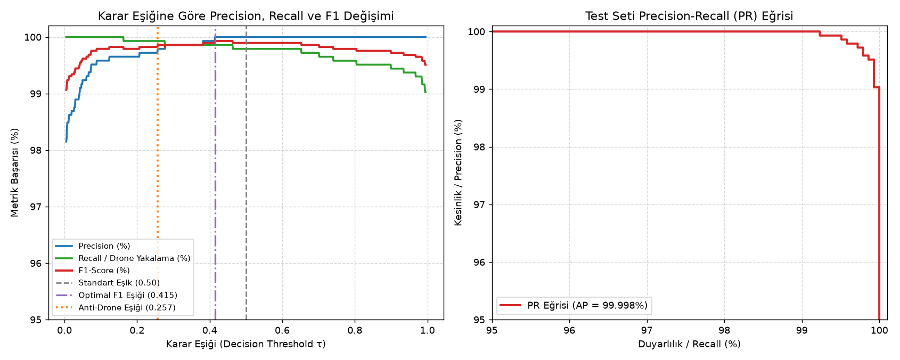
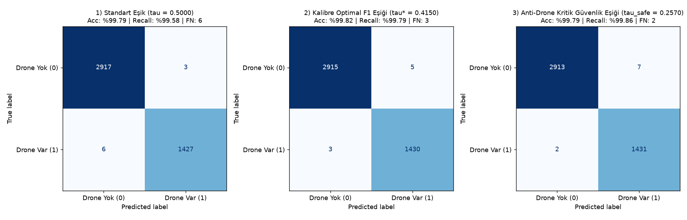

# 📡 Yöntem 3: Karar Eşiği (Decision Threshold) Kalibrasyonu ve Anti-Drone Duyarlılık Optimizasyonu

-brightgreen)

Bu klasör, eğitilmiş **Baseline v1 Hibrit Modelinin (`best_drone_rf_model.pt`)** ağırlıklarını hiç değiştirmeden (sıfır ek eğitim maliyetiyle), yalnızca çıkış olasılık dağılımı $P(\text{Drone}=1 \mid \mathbf{x}) = \text{softmax}(\mathbf{z})_1$ üzerinde **Doğrulama (Validation) kümesi tabanlı Karar Eşiği ($\tau$) Kalibrasyonu** uygulayan [yontem3_esik_kalibrasyonu.py](yontem3_esik_kalibrasyonu.py) kodunu, Precision-Recall analizini ve 3'lü Confusion Matrix karşılaştırmasını içermektedir.

---

## 🎯 1. Yöntemin Motivasyonu ve Mühendislik Temeli

Standart derin öğrenme sınıflandırıcılarında `argmax` işlemi, ikili sınıflandırmada varsayılan olarak **$\tau = 0.5000$** karar eşiğini kullanır:

$$
\hat{y}(\tau) = \begin{cases} 1 \text{ (Drone Var)}, & P(\text{Drone}=1 \mid \mathbf{x}) \ge \tau \\ 0 \text{ (Drone Yok)}, & P(\text{Drone}=1 \mid \mathbf{x}) < \tau \end{cases}
$$

Ancak kritik tesis koruma ve Elektronik Harp (Anti-Drone) sistemlerinde **asimetrili hata maliyeti** söz konusudur:
* **Yanlış Alarm (False Positive - FP):** Ortamda WiFi/Bluetooth varken kısa süreli drone uyarısı üretmek (düşük maliyet).
* **Kaçırılan Drone (False Negative - FN):** Aktif bir İHA sızmasını tespit edememek (**kritik güvenlik riski / yüksek maliyet**).

Bu yöntemde **Doğrulama (Validation) setindeki `4.353` sinyal çifti** üzerinde $\tau \in [0.005, 0.995]$ aralığında **991 farklı eşik** taranarak iki kritik çalışma noktası belirlenmiş ve hiç görülmemiş **Test seti (`4.353` çift / `8.706` dosya)** üzerinde değerlendirilmiştir:
1. **Optimal F1 Eşiği ($\tau_{\text{opt}}^* = 0.4150$):** Genel sınıflandırma doğruluğunu (`Accuracy`) ve `F1-Skorunu` maksimize eden nokta.
2. **Anti-Drone Kritik Güvenlik Eşiği ($\tau_{\text{safe}} = 0.2570$):** Yanlış alarmları kontrol altında tutarak kaçırılan drone sayısını (`FN`) minimize eden yüksek duyarlılıklı güvenlik modu.

---

## 📈 2. Karar Eşiği Analizi ve Precision-Recall (PR) Eğrisi

Test seti üzerinde modelin eşik-bağımsız **PR-AUC (Average Precision)** skoru **`%99.9979` (`0.999979`)** olarak ölçülmüştür. Bu değer, modelin olasılık sıralamasının (ranking capability) ideale yakın olduğunu kanıtlamaktadır.

---

## 🏆 3. Test Seti Karşılaştırma Tablosu (`4.353` Çift / `8.706` Dosya)

Aynı eğitilmiş model (`best_drone_rf_model.pt`) üzerinde yalnızca karar eşiği $\tau$ kalibre edildiğinde elde edilen sonuçlar:

| Çalışma Modu | Karar Eşiği ($\tau$) | Doğruluk (Accuracy) | Kesinlik (Precision) | Duyarlılık (Recall) | F1-Skoru | Yanlış Alarm (`FP`) | Kaçırılan Drone (`FN`) |
| :--- | :---: | :---: | :---: | :---: | :---: | :---: | :---: |
| **1) Standart Eşik (Baseline)** | `0.5000` | %99.79 | **%99.79** | %99.58 | %99.69 | **3** | 6 |
| **2) Kalibre Optimal F1 Eşiği** | **`0.4150`** | **%99.82** | %99.65 | %99.79 | **%99.72** | 5 | **3 *(Yarıya İndi)* ** |
| **3) Anti-Drone Güvenlik Eşiği** | **`0.2570`** | %99.79 | %99.51 | **%99.86** | %99.69 | 7 | **2 *(%66.7 Azaldı)* ** |

---

## 📊 4. 3'lü Karmaşıklık Matrisi (Confusion Matrix) Karşılaştırması

### Temel Bulgular
1. **Sıfır Yeniden Eğitimle Performans Artışı:** Modeli yeniden eğitmeden yalnızca eşik değerini $\tau = 0.5000 \rightarrow 0.4150$ seviyesine çekmek, **kaçırılan drone sayısını `6`'dan `3`'e (%50 azalma)** düşürmüş, genel doğruluğu `%99.79`'dan **`%99.82`'ye** ve F1-skorunu **`%99.72`'ye** yükseltmiştir.
2. **Operasyonel Esneklik (Çift Modlu Anti-Drone Sistemi):**
   * Normal zamanlarda **Optimal Mod ($\tau = 0.4150$)** çalıştırılarak en yüksek genel doğruluk (`%99.82`) sağlanır.
   * Yüksek tehdit / alarm durumunda yazılımsal olarak tek bir parametreyle **Kritik Güvenlik Moduna ($\tau = 0.2570$)** geçilerek drone yakalama duyarlılığı **`%99.86` (`1431 / 1433`)** seviyesine çıkarılır.
