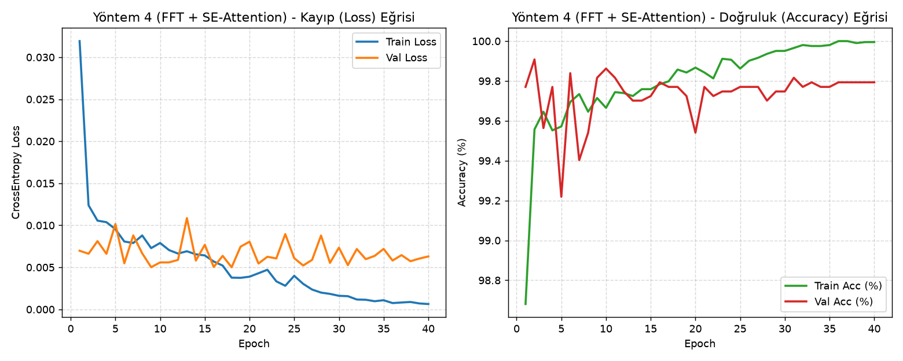
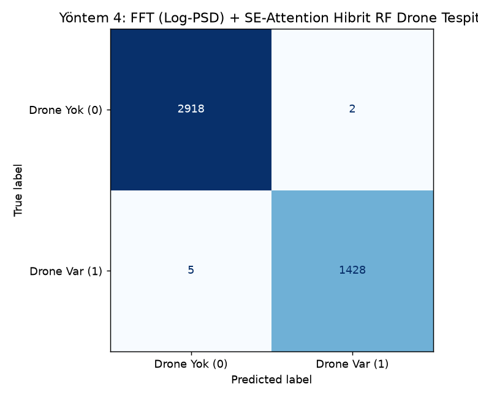

# 📡 Yöntem 4: Frekans Uzayı (FFT Log-PSD) ve Squeeze-and-Excitation (SE) Kanal Dikkat Mekanizmalı Hibrit Model

-brightgreen)

Bu klasör, zaman uzayındaki `[I(t), Q(t), |z(t)|]` bileşenlerine **Hızlı Fourier Dönüşümü (FFT) Logaritmik Güç Spektral Yoğunluğu (Log-PSD)** kanalını ekleyen ve hem 1D-ResNet hem de 2D-CNN katmanlarında **Squeeze-and-Excitation (SE) Kanal Dikkat Mekanizması** ile **Kapılı Çok-Modlu Füzyon (Gated Multimodal Attention)** kullanan `SEHybridRFClassifier` modelinin kodunu ([yontem4_fft_se_attention.py](yontem4_fft_se_attention.py)), öğrenme eğrilerini ve test sonuçlarını içermektedir.

---

## 🎯 1. Yöntemin Matematiksel ve Mimari Yenilikleri

1. **Frekans Uzayı Log-PSD Kanalı ($\text{PSD}(f)$):**
   Zaman uzayındaki karmaşık sinyalin merkezlenmiş Fourier dönüşümü alınarak dB ölçeğindeki güç spektral yoğunluğu doğrudan 4. kanal olarak 1D-SE-ResNet'e verilmiştir:
   $$
   S_{xx}(f) = \log_{10}\Big(\big|\text{fftshift}\big(\mathcal{F}\{z(t)\}\big)\big|^2 + 10^{-6}\Big)
   $$
2. **Squeeze-and-Excitation (SE) Kanal Dikkat Blokları (`SEBlock1D` & `SEBlock2D`):**
   Her evrişim bloğunun çıkışındaki $C$ adet kanalın global enerji ortalamasını sıkıştırıp (`Squeeze`) iki katmanlı darboğaz ağından (`Excitation`) geçirerek arka plan WiFi/Bluetooth gürültüsünü taşıyan kanalları bastırır, drone imzasını taşıyan kanalları güçlendirir.
3. **Kapılı Çok-Modlu Dikkat Füzyonu (`Gated Multimodal Attention`):**
   1D sinyal dalı (`256-d`) ve 2D spektrogram dalı (`256-d`) birleştirildiğinde (`512-d`, toplam `1.320.930` eğitilebilir parametre) $\mathbf{g} = \sigma(\mathbf{W}_2 \text{GELU}(\mathbf{W}_1 \mathbf{h}))$ dikkat kapısıyla her örnek için hangi dalın daha güvenilir olduğuna dinamik ağırlık verilir.

---

## 📈 2. 40 Epoch Kesintisiz Eğitim Özeti ve Öğrenme Eğrileri

Model **NVIDIA GeForce RTX 5060 Laptop GPU** üzerinde **58.038 dosyanın tamamıyla** **40 Epoch** boyunca eğitilmiş ve **18. Epoch'ta `Val Loss: 0.0050`** ile en iyi ağırlıklar kaydedilmiştir.

| Epoch | Süre (sn) | Train Loss | Train Acc (%) | Val Loss | Val Acc (%) | Learning Rate | Durum |
| :---: | :---: | :---: | :---: | :---: | :---: | :---: | :---: |
| **01 / 40** | 11.8s | 0.0319 | %98.68 | 0.0070 | %99.77 | `1.00e-03` | ★ En İyi |
| **02 / 40** | 7.6s | 0.0124 | %99.56 | 0.0066 | %99.91 | `9.98e-04` | ★ En İyi |
| **06 / 40** | 7.6s | 0.0081 | %99.69 | 0.0055 | %99.84 | `9.62e-04` | ★ En İyi |
| **09 / 40** | 23.6s | 0.0073 | %99.71 | 0.0050 | %99.82 | `9.05e-04` | ★ En İyi |
| **18 / 40** | **7.2s** | **0.0038** | **%99.86** | **0.0050** | **%99.77** | **`6.17e-04`** | **★ ZİRVE (Kaydedilen Model)** |
| **31 / 40** | 7.6s | 0.0016 | %99.97 | 0.0053 | %99.82 | `1.47e-04` | Yakınsama |
| **36 / 40** | 13.2s | 0.0007 | %100.00 | 0.0058 | %99.79 | `3.90e-05` | Tam Yakınsama |
| **40 / 40** | 10.7s | 0.0006 | %100.00 | 0.0063 | %99.79 | `2.54e-06` | Eğitim Sonu |

---

## 🏆 3. Test Seti Sonuçları ve Confusion Matrix (`4.353` Çift / `8.706` Dosya)

| Sınıf | Kesinlik (Precision) | Duyarlılık (Recall) | F1-Skoru (F1-Score) | Örnek Sayısı (Support) |
| :--- | :---: | :---: | :---: | :---: |
| **`Drone Yok (0)`** | **%99.83 (`0.9983`)** | **%99.93 (`0.9993`)** | **%99.88 (`0.9988`)** | 2.920 |
| **`Drone Var (1)`** | **%99.86 (`0.9986`)** | **%99.65 (`0.9965`)** | **%99.76 (`0.9976`)** | 1.433 |
| **Macro Avg** | **%99.84 (`0.9984`)** | **%99.79 (`0.9979`)** | **%99.82 (`0.9982`)** | **4.353** |
| **Weighted Avg / Accuracy** | **%99.84 (`0.9984`)** | **%99.84 (`0.9984`)** | **%99.84 (`0.9984`)** | **4.353** |

### Karmaşıklık Matrisi (Confusion Matrix)

| Gerçek \ Tahmin | Tahmin: `Drone Yok (0)` | Tahmin: `Drone Var (1)` | Toplam |
| :--- | :---: | :---: | :---: |
| **Gerçek: `Drone Yok (0)`** | **2.918** *(True Negative - %99.93 Özgüllük!)* | **2** *(False Positive - Yalnızca 2 Yanlış Alarm!)* | 2.920 |
| **Gerçek: `Drone Var (1)`** | **5** *(False Negative - FN)* | **1.428** *(True Positive - TP)* | 1.433 |

---

## 📊 4. Baseline (v1) ve Yöntem 2 ile Karşılaştırmalı Analiz

| Metrik | Baseline (v1: 2-Kanal `[I, Q]`) | Yöntem 2 (4-Kanal Faz `∠IQ`) | Yöntem 4 (`FFT Log-PSD + SE-Attention`) | Yöntem 4'ün Öne Çıkan Gücü |
| :--- | :---: | :---: | :---: | :--- |
| **Test Doğruluğu (`Accuracy`)** | %99.79 | **%99.89** | %99.84 | Baseline'a göre toplam hata 9'dan 7'ye indi |
| **Drone Kesinliği (`Precision`)** | %99.79 | %99.72 | **%99.86 *(En Yüksek)* ** | **En düşük yanlış alarm oranı** |
| **Yanlış Alarm Sayısı (`FP`)** | 3 / 2920 | 4 / 2920 | **2 / 2920 *(En Düşük - %0.068)* ** | **SE-Attention arka plan gürültüsünü bastırdı** |
| **Drone Duyarlılığı (`Recall`)** | %99.58 | **%99.93 *(En Yüksek)* ** | %99.65 | Faz kanalı (`Yöntem 2`) Recall'da, FFT+SE (`Yöntem 4`) Precision'da lider |
| **Drone F1-Skoru** | %99.69 | **%99.83** | %99.76 | +0.07 puan iyileşme |
