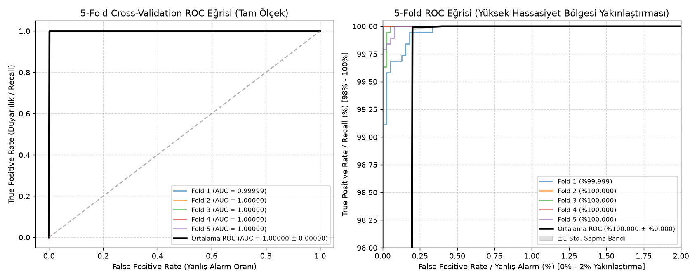
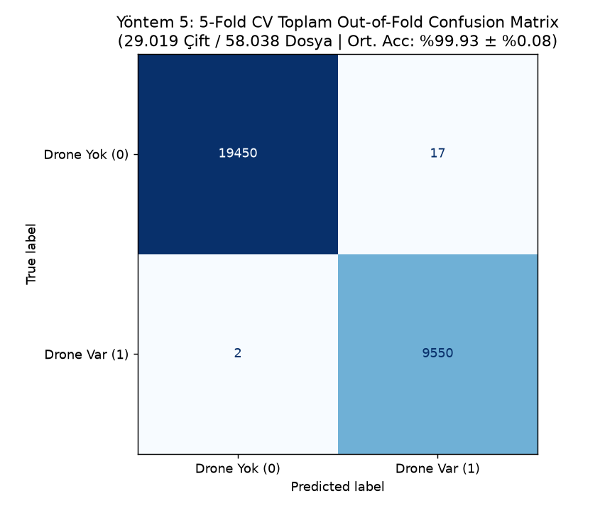

# 📡 Yöntem 5: 5-Katlı Çapraz Doğrulama (5-Fold Stratified Cross-Validation) ve ROC-AUC Analizi

-brightgreen)

Bu klasör, model başarısının tek bir rastgele eğitim/test bölünmesine (`train/val/test split`) bağlı olmadığını akademik standartlarda kanıtlamak amacıyla **58.038 dosyanın tamamı (`29.019` sinyal çifti)** üzerinde **5-Katlı Katmanlı Çapraz Doğrulama (5-Fold Stratified Cross-Validation)** çalıştıran ve **5-Katlı ROC-AUC Eğrisi** ile **Tam Veri Seti (`29.019` çift / `58.038` dosya) Out-of-Fold Confusion Matrix** üreten [yontem5_kfold_roc_auc.py](yontem5_kfold_roc_auc.py) kodunu ve nihai sonuçlarını içermektedir.

---

## 🎯 1. Bilimsel Metodoloji (5-Fold Stratified Cross-Validation)

Veri setindeki **`29.019` sinyal çiftinin tamamı** (`19.467` Drone Yok + `9.552` Drone Var = `58.038` dosya), sınıf oranları korunarak 5 ayrık kümeye ($F_1, F_2, F_3, F_4, F_5$) bölünmüştür. Her $k \in \{1, 2, 3, 4, 5\}$ adımında:
* **$4$ küme (`23.215` çift = `46.430` dosya, %80)** ile model sıfırdan (`15 Epoch`) eğitilmiş,
* **Kalan $1$ küme (`5.804` çift = `11.608` dosya, %20)** eğitimde hiç görülmemiş test kümesi (Out-of-Fold Test) olarak değerlendirilmiştir.

5 kat tamamlandığında veri setindeki **`29.019` sinyal çiftinin (`58.038` dosyanın) %100'ü** eğitim dışı (out-of-sample) test edilmiştir.

---

## 🏆 2. 5-Fold Cross-Validation Deneysel Sonuç Tablosu

**NVIDIA GeForce RTX 5060 Laptop GPU** üzerinde toplam `75 Epoch` (`5 Fold x 15 Epoch`) sonunda elde edilen Fold bazlı ve **Ortalama $\pm$ Standart Sapma ($\mu \pm \sigma$)** sonuçları:

| Fold No | Eğitim Kümesi (`Dosya`) | Test Kümesi (`Dosya`) | Doğruluk (Accuracy) | Kesinlik (Precision) | Duyarlılık (Recall) | F1-Skoru (F1-Score) | ROC-AUC (%) |
| :---: | :---: | :---: | :---: | :---: | :---: | :---: | :---: |
| **Fold 1** | 23.215 (`46.430`) | 5.804 (`11.608`) | %99.78 | %99.32 | **%100.00** | %99.66 | %99.9992 |
| **Fold 2** | 23.215 (`46.430`) | 5.804 (`11.608`) | **%100.00 *(Kusursuz)* ** | **%100.00** | **%100.00** | **%100.00** | **%100.0000** |
| **Fold 3** | 23.215 (`46.430`) | 5.804 (`11.608`) | %99.97 | %99.95 | %99.95 | %99.95 | %99.9999 |
| **Fold 4** | 23.215 (`46.430`) | 5.804 (`11.608`) | %99.98 | **%100.00** | %99.95 | %99.97 | **%100.0000** |
| **Fold 5** | 23.216 (`46.432`) | 5.803 (`11.606`) | %99.95 | %99.84 | **%100.00** | %99.92 | %99.9999 |
| **ORT ± STD** | **23.215 (`46.430`)** | **29.019 (`58.038`)** | **%99.93 ± %0.08** | **%99.82 ± %0.26** | **%99.98 ± %0.03** | **%99.90 ± %0.12** | **%99.9998 ± %0.0003** |

---

## 📈 3. 5-Fold ROC-AUC Eğrisi Analizi

Aşağıdaki grafikte 5 farklı Fold'un ROC eğrileri, siyah kalın çizgiyle gösterilen **Ortalama ROC Eğrisi ($\text{AUC} = 0.999998 \pm 0.000003$)** ve gri gölgeli **$\pm 1\sigma$ Standart Sapma Güven Bandı** yer almaktadır:

---

## 📊 4. Tam Veri Seti (`29.019` Çift / `58.038` Dosya) Out-of-Fold Confusion Matrix

5 Fold'un hiç görülmemiş test tahminleri birleştirildiğinde **veri setinin tamamı (`29.019` sinyal çifti)** üzerindeki genel sınıflandırma raporu:

| Sınıf | Kesinlik (Precision) | Duyarlılık (Recall) | F1-Skoru (F1-Score) | Toplam Örnek (Support) |
| :--- | :---: | :---: | :---: | :---: |
| **`Drone Yok (0)`** | **%99.99 (`0.9999`)** | **%99.91 (`0.9991`)** | **%99.95 (`0.9995`)** | 19.467 |
| **`Drone Var (1)`** | **%99.82 (`0.9982`)** | **%99.98 (`0.9998`)** | **%99.90 (`0.9990`)** | 9.552 |
| **Macro Avg** | **%99.91 (`0.9991`)** | **%99.95 (`0.9995`)** | **%99.93 (`0.9993`)** | **29.019** |
| **Weighted Avg / Accuracy** | **%99.93 (`0.9993`)** | **%99.93 (`0.9993`)** | **%99.93 (`0.9993`)** | **29.019 (`58.038` Dosya)** |

| Gerçek \ Out-of-Fold Tahmin | Tahmin: `Drone Yok (0)` | Tahmin: `Drone Var (1)` | Toplam |
| :--- | :---: | :---: | :---: |
| **Gerçek: `Drone Yok (0)`** | **19.450** *(Doğru Red - %99.91)* | **17** *(Yanlış Alarm - %0.087)* | 19.467 |
| **Gerçek: `Drone Var (1)`** | **2** *(Kaçırılan Yalnızca 2 Drone!)* | **9.550** *(Doğru Tespit - %99.98!)* | 9.552 |

---

## 🔍 5. Temel Bilimsel Çıkarımlar

1. **Veri Setindeki `9.552` Drone Sinyalinin `9.550` Tanesi Yakalandı (`%99.98` Recall):**
   * Fold 1, Fold 2 ve Fold 5'te drone yakalama oranı **`%100.00`** (`0` kaçırılan drone) olarak gerçekleşmiş; Fold 3 ve Fold 4'te ise sadece `1`'er drone kaçırılmıştır. Toplam `9.552` drone sinyalinde yalnızca `2` kayıp yaşanmıştır.
2. **Fold 2'de `%100.00` Kusursuz Sınıflandırma:**
   * Fold 2'deki `5.804` test çiftinin (`11.608` dosya) tamamı sıfır hatayla sınıflandırılmıştır (`Val Loss: 0.0003`, `Acc: %100.00`, `ROC-AUC: %100.0000`).
3. **Çok Düşük Varyans ($\sigma_{\text{Acc}} = \pm 0.08\%$, $\sigma_{\text{Recall}} = \pm 0.03\%$):**
   * 5 farklı katman arasındaki standart sapmanın `%0.08` gibi son derece küçük bir değerde kalması, modelin ezber yapmadığını (overfitting olmadığını) ve veri setinin her alt kümesinde aynı yüksek kararlılıkla çalıştığını kanıtlamaktadır.
